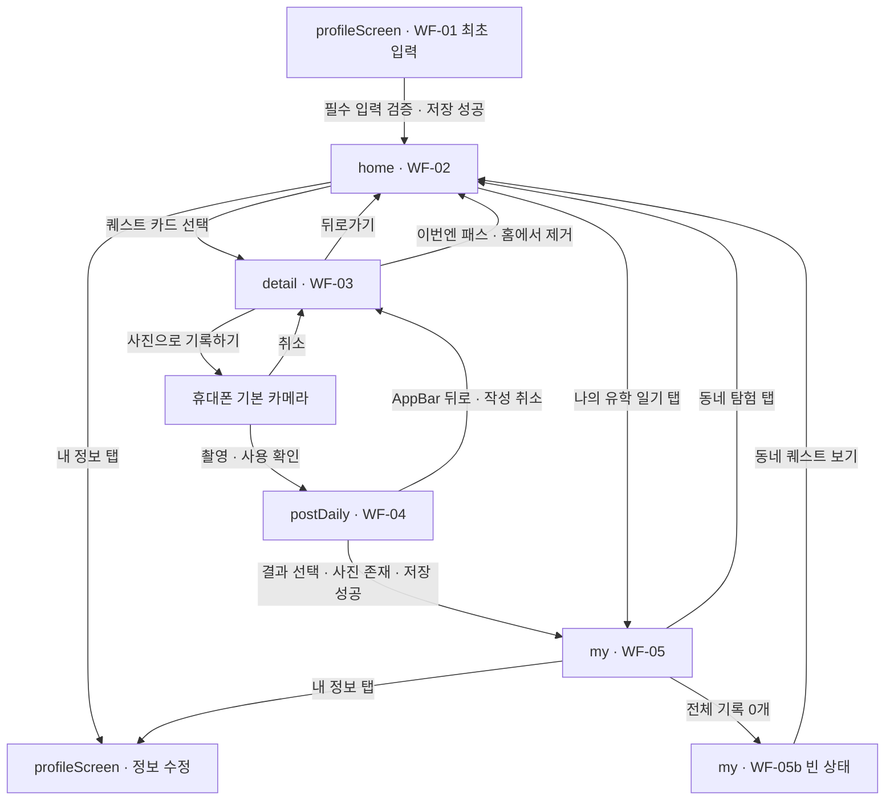

# 화면설계서 · 화면 명칭과 이동 흐름

## 문서 기준

첨부된 화면설계서 5장과 각 이미지의 Dev Handoff를 정리한 목표 동작 명세다. 현재 코드나 API의 구현 완료를 의미하지 않는다.

- 화면명은 사용자가 지정한 `profileScreen`, `home`, `detail`, `postDaily`, `my`를 그대로 사용한다. Kotlin 클래스·함수의 대문자 표기와 문서의 화면 식별명은 구분한다.
- 같은 이미지에서 본문과 Dev Handoff가 충돌하면 **확정본 우선**, UI-02b·UI-04a·UI-05b는 해당 상태의 보충 명세로 적용한다.
- 화면설계서의 설명 카드·Dev Handoff 카드는 개발 참고 자료이며 앱에 표시하는 UI가 아니다.
- 기존 `AGENTS-wireframe-review.md`의 추가 제안이나 이전 정책을 이번 첨부 설계서의 확정 사항으로 가져오지 않는다.

## 화면 이름 매핑

| 와이어프레임 | 화면 식별명 | 화면 역할 | 관련 핸드오프 |
| --- | --- | --- | --- |
| WF-01 · 회원가입 | `profileScreen` | 최초 프로필 입력, 내 정보 조회·수정에 폼 재사용 | 별도 핸드오프 없음 |
| WF-02 · 홈 · 주변 퀘스트 | `home` | 체류 현황과 남은 추천 퀘스트 | UI-02, UI-02b |
| WF-03 · 퀘스트 상세 | `detail` | 퀘스트 안내, 패스, 사진 기록 진입 | UI-03 |
| WF-04 · 일기 작성 · 촬영 후 | `postDaily` | 촬영 사진과 경험 여부·메모를 일기로 저장 | UI-04, UI-04a |
| WF-05 · 나의 유학 일기 | `my` | 저장한 일기 목록과 집계 조회 | UI-05 |
| WF-05b · 유학 일기 빈 상태 | `my`의 빈 상태 | 저장된 일기가 0개일 때 탐색 안내 | UI-05b |

이 문서에서 `my`는 일기 목록이다. 하단 메뉴의 **내 정보는 `profileScreen`**이다.

## 전체 플로우

- 기본 카메라는 촬영을 위한 외부 동작이며, 별도의 와이어프레임 화면명으로 추가하지 않는다.
- `profileScreen` 최초 저장 성공은 `home`으로 이어진다. 내 정보 수정 후 복귀 목적지는 설계서에 명시되어 있지 않다.
- 하단 메뉴: **동네 탐험 / 나의 유학 일기 / 내 정보**. 활성 탭은 각각 `home` / `my` / `profileScreen`이다.
- `detail`에서 패스하거나 `postDaily`에서 저장에 성공한 퀘스트는 `home`의 남은 목록에서 제거한다. 새로운 퀘스트로 보충하지 않는다.
- `postDaily` 작성 취소·카메라 취소는 일기를 생성하지 않으며 퀘스트를 홈에 유지한다.

## 1. profileScreen · WF-01

### 목적과 입력

사용자 프로필과 관심사를 저장해 퀘스트 추천에 필요한 기본 정보를 설정한다.

| 입력 항목 | 설계서 규칙 |
| --- | --- |
| 닉네임 | 화면 기준 2~12자 |
| 사용 언어 | 입력 항목으로 포함. 선택지·변경 정책은 별도 확인 필요 |
| 생년월일 | 기본 프로필 정보 |
| 한국 체류 시작일·종료일 | 종료일은 시작일 이후이며 같은 날도 허용 |
| 관심사 | 1개 이상 선택 |

관심사: KPOP, 드라마, 영화, 뷰티, 음식, 웹툰, 게임, 패션, 관광.

### 동작과 저장

- 정보 저장하기 → 필수 입력 검증 → 저장 성공 시 `home`.
- 내 정보 탭에서는 저장한 정보를 표시하고 수정·저장한다. 최초 입력과 정보 수정을 같은 폼으로 처리한다.
- 체류 날짜는 홈의 D-day·기간 표시에 사용하고 추천 조건에는 포함하지 않는다.
- 국가·생활 동네는 수집하지 않는다.
- 화면 언어에 맞춰 안내한다. 프로토타입의 브라우저 저장과 실제 계정 인증은 구분한다. 브라우저 저장을 Android 저장 방식으로 그대로 확정하지 않는다.

## 2. home · WF-02 / UI-02 / UI-02b

### 표시와 추천

- 체류 카드(StayCard): 귀국 D-day, 체류 시작·종료일, 경과 비율.
- 퀘스트 카드: 카테고리, 예상 시간, 제목, 장소, 추천 근거.
- 사용자 정보·관심사 기반으로 추천한다. 체류 날짜는 추천에 사용하지 않는다.
- 확정 핸드오프 기준 하루 **3개**를 제공한다. 본문의 카드 2개 예시보다 우선한다.
- **Asia/Seoul 자정 기준 첫 접속 시 생성**, 반경 **3km**, 같은 날 재접속 시 같은 묶음을 유지한다.
- 남은 퀘스트만 표시한다. 패스·기록 시 제거하고 보충하지 않는다.
- 홈에는 지도가 없으며, MVP에서 위치 권한 요청·안내 전용 흐름을 별도로 만들지 않는다.
- UI-02 확정본은 앱 진입 시 OS 위치 권한을 필수로 요청하고 거부 시 이용 불가로 명시한다. 거부 상태의 상세 UX는 제외되어 있다.

### 이동과 빈 상태

- 퀘스트 카드 → 해당 퀘스트의 `detail`.
- 동네 탐험 탭은 현재 `home`, 나의 유학 일기 탭 → `my`, 내 정보 탭 → `profileScreen`.
- 남은 퀘스트가 0개이면 **“오늘 진행할 퀘스트가 없어요!”**를 표시한다.
- StayCard는 유지하고 퀘스트 영역만 빈 상태(QuestEmpty)로 바꾼다. `my`의 기록 0개 상태와 다르다.
- 목록 스크롤과 하단 메뉴를 제공하며, 현재 수치와 카드 수는 UI 예시와 실제 데이터를 구분한다.

### 핸드오프 스타일

- DS/StayCard, DS/QuestCard 사용, 리스트 gap 12, BottomNav Active=Explore.
- QuestEmpty: surface + Elevation 1, padding 32/20, gap 12.

## 3. detail · WF-03 / UI-03

### 주요 표시

- 대표 이미지, 카테고리, 예상 시간, 제목, AI 추천 근거, 소개문, 단계별 작은 도전.
- 내장 지도에 퀘스트 장소 핀 1개를 표시한다. MVP 위치 권한 요청·안내 흐름은 별도로 추가하지 않는다.
- 대표 이미지는 팀 준비본을 사용하고 지도는 Google Maps Platform을 사용한다.

### 동작과 촬영

- 뒤로 → `home`.
- 이번엔 패스 → `home`에서 해당 퀘스트 제거 → `home`. 새 퀘스트는 보충하지 않는다.
- 사진으로 기록하기 → 앱 내부 촬영 화면 없이 **휴대폰 기본 카메라** 실행.
- 촬영 후 사용 확인 → 사진을 받아 `postDaily`로 이동.
- 카메라 취소 → `detail` 유지·복귀. 일기를 생성하지 않는다.
- 패스 시 사진·메모·일기 저장을 요구하지 않는다.
- 완료 여부를 검수하거나 승인하는 단계는 두지 않는다.
- 하단 CTA: 패스 Secondary 112 / 기록 Primary Fill.

## 4. postDaily · WF-04 / UI-04 / UI-04a

### 입력과 검증

| 항목 | 적용 규칙 |
| --- | --- |
| 퀘스트 정보 | 제목·장소 표시 |
| 경험 결과 | **“해봤어요!” / “이번엔 못했어요”** 중 사용자가 직접 선택 |
| 사진 | `detail`에서 기본 카메라로 촬영·확인한 사진 **1장 필수** |
| 한 줄 메모 | 선택 입력, **최대 50자**, 51자 입력 불가 |
| 저장 버튼 | 결과 선택 + 사진 존재 시 Primary 활성 |

본문의 메모 최대 120자보다 UI-04 확정본의 50자를 우선한다. 경험 결과도 확정된 라벨을 사용한다.

### 저장·취소·오류

- “내 유학 일기에 남기기” → 정상 저장 성공 시 `my` 목록으로 이동.
- 메모는 공란이어도 저장 가능하다.
- “이번엔 못했어요”도 동일하게 정상 일기로 저장 가능하다.
- 결과 미선택·사진 없음: 저장 불가, 필요한 항목 안내.
- 저장 실패: 사진·메모·선택 상태를 유지하고 재시도를 제공한다.
- 저장 중 중복 제출을 방지한다. 저장 성공 시 해당 퀘스트를 `home`에서 제거한다.
- AppBar 뒤로 → 작성 취소 → `detail`. 일기는 생성하지 않고 퀘스트는 홈에 유지한다.
- 작성 화면에 **다시 찍기 기능은 없다**. 사진을 바꾸려면 작성 취소 → `detail`에서 재촬영한다.
- 갤러리 파일 첨부 방식이 아니다. 사진 검수·AI 성공 판정도 하지 않는다.

## 5. my · WF-05 / UI-05

### 목록과 집계

- 필터 없이 저장한 모든 경험 기록을 시간순으로 확인한다. 월별로 묶어 표시한다.
- StatRow: 전체 기록 수 / 경험 수 / 못 경험 수.
- 카드: 사진, 날짜, 장소, 결과, 퀘스트명, 선택 메모.
- 메모는 사용자가 쓴 원문 그대로 보존해 표시한다.
- 경험 여부와 관계없이 모든 기록을 같은 목록에 보여준다. 못 경험한 기록도 숨기거나 감점하지 않는다.
- 언어 표시(KO)는 서비스 언어 변경 진입 요소로 설명되어 있다. 지원 언어·변경 동작은 별도 확인한다.

### 동작과 제외 기능

- 동네 탐험 탭 → `home`, 내 정보 탭 → `profileScreen`.
- 전체 기록 0개 → 같은 `my` 화면의 WF-05b 빈 상태.
- **보기 전용**이며 수정·삭제·상세 필터·재도전 기능을 제공하지 않는다.
- 시도 횟수·재도전 안내도 MVP에서 제외한다. 별도 일기 상세 화면 이동은 설계서에 명시되어 있지 않다.

### my 빈 상태 · WF-05b / UI-05b

- 전체 저장 일기가 0개인 최초 이용 또는 모든 기록이 없는 상태다. 특정 필터 결과만 0개인 상태가 아니다.
- “아직 기록이 없어요”와 사진으로 경험을 남기라는 설명을 표시한다.
- 주요 버튼 **“동네 퀘스트 보기”** → `home`.
- 일기가 생성되면 `my` 일반 목록으로 전환한다.
- 첫 기록 전에 촬영을 강요하지 않고 퀘스트 탐색으로 안내한다.
- BottomNav Active=Diary. 위치 권한 요청·안내 흐름은 이 화면의 MVP 범위에서 제외한다.

## 구현 전 확인이 필요한 항목

아래 사항은 첨부 자료에서 확정되지 않았으므로 API나 기존 구현을 확인한다.

- 인증·가입 상태 확인 방식, 가입 완료 사용자의 앱 시작 목적지.
- 사용 언어 선택지와 KO 언어 변경 동작. 이번 첨부에는 언어 기능을 제거한다는 지시가 없다.
- `profileScreen` 정보 수정 저장 후 복귀 위치와 하단 메뉴 표시 범위.
- 퀘스트·일기 ID 타입, API 경로·필드명, 사진 업로드 방식, 저장·패스 반영 방식.
- 날짜·D-day·경과 비율 계산 책임과 경계값, 일기 시간순의 오름차순·내림차순.
- Android 시스템 뒤로가기의 세부 정책. AppBar의 명시된 취소·복귀 동작과 충돌하지 않도록 연결한다.

## 플로우 확인 목록

- 최초 정보 저장 후 `home`으로 이동하는가?
- 하단 메뉴의 나의 유학 일기는 `my`, 내 정보는 `profileScreen`으로 이동하는가?
- `home → detail → 기본 카메라 → postDaily → my`로 이어지는가?
- 카메라 취소 시 `detail`로 복귀하고 일기가 생성되지 않는가?
- 패스·저장 완료 퀘스트만 홈에서 제거되고, 같은 날 보충되지 않는가?
- 홈의 남은 퀘스트 0개 상태에서도 체류 카드가 유지되는가?
- `postDaily`는 사진·결과가 있어야 저장되고, 메모는 50자를 넘지 않는가?
- 못 경험한 결과·빈 메모도 저장되며, 저장 실패 시 작성값이 유지되는가?
- 작성 취소 시 상세로 돌아가고 일기 생성·퀘스트 제거가 발생하지 않는가?
- `my` 기록 0개 CTA가 `home`으로 연결되고, 기록이 생기면 목록으로 바뀌는가?
